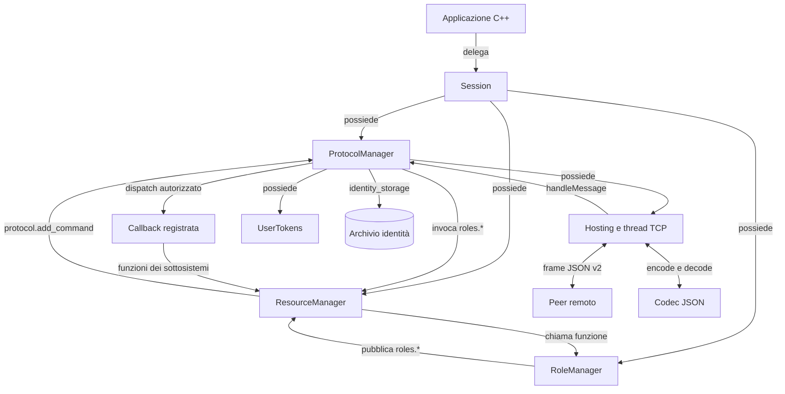
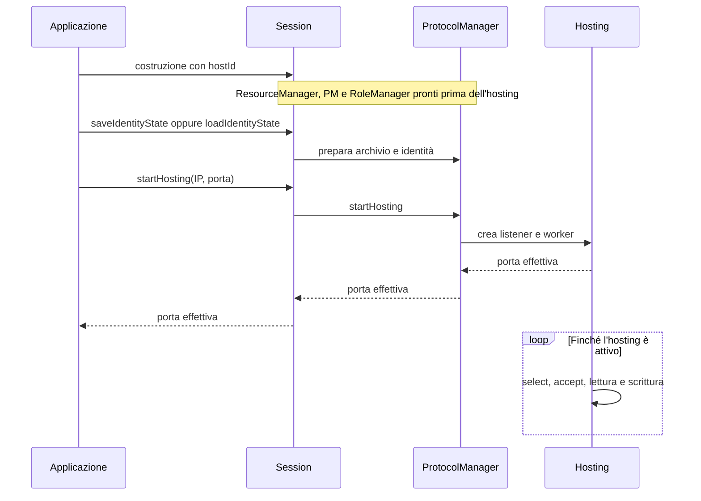
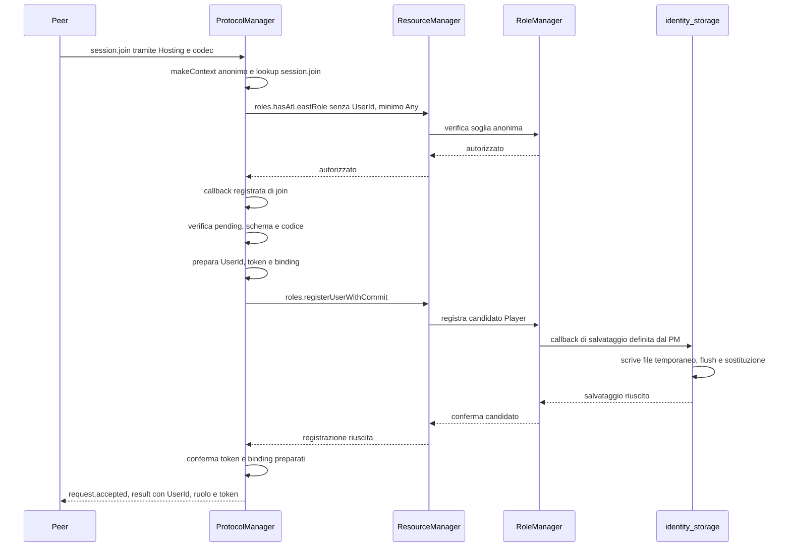
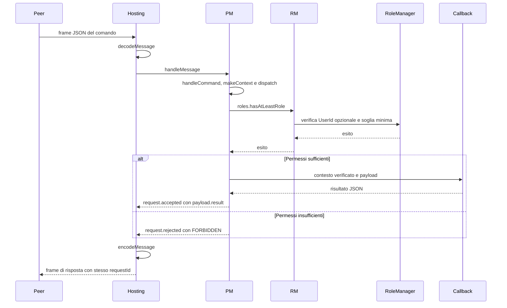
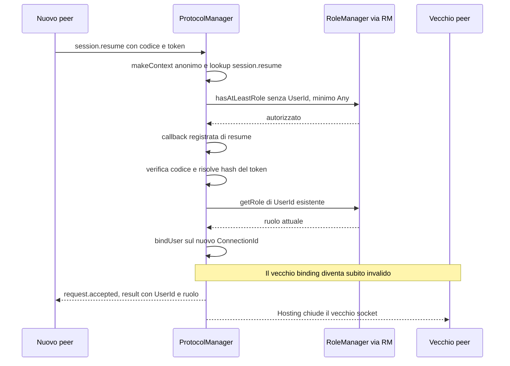
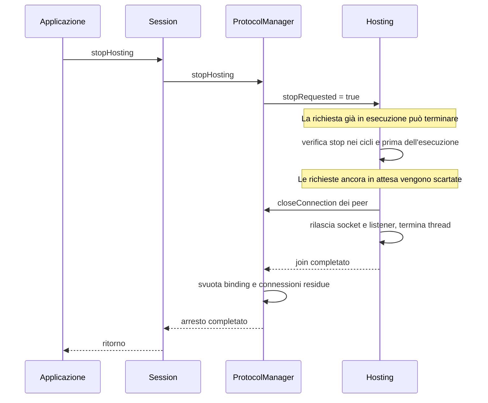

# Riesame del flusso delle comunicazioni

Riesame del 2026-11-12, aggiornato dopo il dispatch comune e la correzione dello stop. Entrambi i problemi riprodotti sono risolti. I diagrammi descrivono il codice attuale; le riproduzioni precedenti sono in [history/2026-11-12-admission-routing.md](history/2026-11-12-admission-routing.md) e [history/2026-11-12-buffered-stop.md](history/2026-11-12-buffered-stop.md).

## Esito del riesame

| Stato | Punto | Evidenza | Intervento |
| --- | --- | --- | --- |
| Risolto | Collisione fra comandi registrati e messaggi di ammissione | I test rifiutano registrazioni duplicate dei due nomi e delle varianti con spazi. Join/resume con spazi seguono le stesse callback e risposte degli altri comandi. | Entrambi registrati nel costruttore con `add_command(..., Role::Any, ...)`; rimossa la selezione separata dei nomi. |
| Risolto | Richieste bufferizzate o in attesa del lock possono partire durante lo stop | Due nuove regressioni falliscono contro la libreria precedente e passano con la correzione: secondo peer bufferizzato e richiesta remota dietro una callback locale. | Controlli nel ciclo dei buffer, prima di select e nel percorso comune di input, con un ultimo controllo sotto il mutex di esecuzione. |

La correzione dei nomi usa [protocol_manager.cpp](../core/play/src/protocol_manager.cpp), `add_command`/`normalizedName`, e [admission.cpp](../core/play/src/admission.cpp), `registerAdmissionCommands`/`handleMessage`. La correzione dello stop è in [hosting.cpp](../core/play/src/hosting.cpp), senza nuove API pubbliche o manager.

La verifica completa delle undici suite sul dispatch Any è in `build/play/any-commands/`. La successiva correzione dello stop passa le quattro suite interessate (admission, hosting, ProtocolManager e persistenza) e il test del processo host con riavvio/ripresa, in `build/play/stop-buffered/`. I vecchi probe del riesame restano separati e non sono test di accettazione delle correzioni. Esecuzione POSIX e configurazione CMake restano da verificare.

La correzione dello stop comprende tre parti:

1. `poll` verifica lo stop prima di ogni peer con messaggi bufferizzati e prima di attendere select; il ciclo dei socket conserva il proprio controllo.
2. `processInput`, usato sia per i buffer sia per i dati appena ricevuti, verifica lo stop all'ingresso e dopo aver ottenuto il mutex di esecuzione, prima di `handleMessage`. Una richiesta che supera quest'ultimo controllo è già in esecuzione e può terminare; le altre vengono scartate durante la chiusura.
3. I test in [admission_test.cpp](../core/play/tests/admission_test.cpp) coordinano callback e stop, verificano il completamento della richiesta attiva, l'esclusione del lavoro in coda, la chiusura dei peer e il riavvio con identità/ruolo/token conservati. Coprono anche l'attesa dietro una callback locale.

## Proprietà dello stato e collegamenti



- Session possiede i tre componenti e delega. La sua distruzione ferma il worker prima di distruggere i provider.
- ResourceManager è il registro delle funzioni interne condiviso per riferimento nella singola Session. Non riceve direttamente i messaggi TCP.
- Il registro dei comandi remoti è `ProtocolManager::commands_`: contiene nome, ruolo minimo e callback, inclusi join/resume con Any, registrati prima di pubblicare `protocol.add_command`. Non coincide con il registro delle feature di ResourceManager.
- RoleManager è l'autorità sui ruoli. ProtocolManager verifica sempre il livello minimo tramite RM, anche per Any. La gerarchia è Host, Master, Player, Spectator, Any; Any è solo una soglia, non assegnabile né persistibile. Un contesto anonimo valido ha ConnectionId ma nessun UserId; record chiusi/sostituiti non sono anonimi validi. Il sottosistema chiamato resta responsabile dei permessi specifici dell'operazione.
- Hosting possiede socket, buffer e thread. Il codec è un insieme di funzioni private senza stato di ruoli o identità.
- UserTokens conserva hash; l'archivio conserva UserId, ruoli e hash. Socket, binding e codice di sessione non vengono salvati in quell'archivio.

`roles.getRole` è quindi una feature interna. Il client che invia quel nome non ottiene automaticamente un RPC: serve una registrazione esplicita tramite `protocol.add_command`.

## Avvio dell'hosting



Il ruolo Host esiste già prima del listener e non richiede un collegamento TCP locale. Il codice è generato alla costruzione di ProtocolManager. La porta `0` richiede una porta assegnata dal sistema operativo. Il backend non richiede polling pubblico.

## Primo ingresso



Nel diagramma l'ingresso/uscita tramite Hosting è riassunto nelle frecce del peer. RoleManager non conosce il file: invoca una callback che usa `identity_storage`, senza rientrare nei metodi dei manager. I binding preparati non sono osservabili da altri thread durante il commit perché il percorso mantiene i lock necessari. Un errore prima del commit scarta il candidato; restano le normali incertezze di durabilità in caso di errore I/O dopo una sostituzione del file.

Il token originale viene restituito soltanto al nuovo utente. Se la connessione cade dopo il salvataggio e prima che il client conservi la risposta, oggi non esiste un recupero di quella credenziale.

## Dispatch comune dei comandi



PM significa ProtocolManager e RM ResourceManager. Il percorso è lo stesso per join, resume e tutti gli altri nomi, ed è serializzato con sostituzione e chiusura. La callback non mantiene i mutex di connessioni o ruoli; può registrare altri comandi o richiamare dispatch in modo annidato. Le chiamate locali e remote usano gli stessi controlli. Un contesto locale senza ConnectionId richiede un UserId noto. Un comando Any generico può essere eseguito da un peer ancora anonimo, senza ammetterlo né prolungare il limite di cinque secondi.

Un risultato non serializzabile o troppo grande produce `COMMAND_FAILED`, senza ripetere la callback: la connessione resta aperta se ammessa, si chiude se ancora anonima. La risposta di errore non annulla eventuali effetti già prodotti dalla callback.

## Resume e sostituzione della connessione



Il token e l'identità restano gli stessi. La chiusura fisica del vecchio socket segue l'invalidazione logica; non è prevista una notifica `session.replaced`. Un suo messaggio tardivo non può iniziare una callback dopo la sostituzione; può essere scartato chiudendo il socket, senza una risposta JSON garantita.

## Disconnessione e arresto



Uno stop conserva ruoli, token, archivio configurato, codice e contatore dei ConnectionId nella Session viva. Non svuota la coda eseguendo i messaggi: scarta i buffer durante la chiusura, quindi non garantisce l'invio dell'ultima risposta. Il dispatch locale fidato resta indipendente dall'hosting. Ricreando la Session, l'archivio ripristina identità/ruoli/token, ma il codice viene rigenerato e il contatore è quello della nuova istanza. Le operazioni di ciclo di vita e il caricamento dell'archivio non sono ammessi dall'interno di una callback dello stesso ProtocolManager.

## Esempi delle operazioni principali

I JSON seguenti rappresentano singoli corpi di messaggio. Sul TCP ogni corpo è preceduto da quattro byte che indicano la lunghezza UTF-8, in ordine big-endian. Gli identificatori e il token sono esemplificativi. Il protocollo usa versione 2; il file dell'archivio ha una propria versione indipendente.

### Creare o riaprire e hostare

```cpp
golarion::play::Session session("host");
const std::filesystem::path archive("session-identities.json");
if (std::filesystem::exists(archive)) session.loadIdentityState(archive);
else session.saveIdentityState(archive);
const auto port = session.startHosting("0.0.0.0", 42500);
const auto code = session.getSessionCode();
// Keep the application alive while the backend worker runs.
```

Il tool console esegue questo percorso e stampa endpoint/codice. Accetta IP, porta e percorso opzionale dell'archivio. L'applicazione deve mantenere viva Session.

### Entrare come nuovo Player

Richiesta:

```json
{"version":2,"type":"session.join","requestId":"j1","payload":{"sessionCode":"A7K2Q"}}
```

Risposta:

```json
{"version":2,"type":"request.accepted","requestId":"j1","payload":{"result":{"userId":"user-0011223344556677","role":"player","userToken":"a1b2c3d4e5f60718"}}}
```

Il client conserva il token. L'host conserva soltanto il suo hash e i dati dell'identità. Non si inviano nome visibile, ruolo scelto dal client o UserId scelto dal client.

### Registrare e usare un comando

Questo codice è illustrativo e appartiene a un sottosistema che riceve ResourceManager per riferimento. `demo.echo` non è un comando preinstallato nel tool host.

```cpp
resources.invoke<golarion::play::ProtocolManager::AddCommandSignature>("protocol.add_command", "demo.echo", golarion::play::Role::Player, [](const golarion::play::CommandContext &context, const nlohmann::json &payload)
{
    return nlohmann::json{{"actor", *context.userId}, {"echo", payload}};
});
```

Richiesta dopo l'ammissione:

```json
{"version":2,"type":"demo.echo","requestId":"c1","payload":{"value":7}}
```

Risposta della callback illustrata:

```json
{"version":2,"type":"request.accepted","requestId":"c1","payload":{"result":{"actor":"user-0011223344556677","echo":{"value":7}}}}
```

Un campo `userId` nel payload non sostituisce `context.userId`. I controlli specifici dell'operazione appartengono alla callback e al relativo dominio.

### Permesso negato e comando non registrato

Un Player che richiama un comando registrato con ruolo minimo Master riceve:

```json
{"version":2,"type":"request.rejected","requestId":"c2","payload":{"code":"FORBIDDEN","message":"Non hai i permessi per eseguire questo comando."}}
```

Un nome non registrato, per esempio `users.setRole` nel tool host corrente, riceve:

```json
{"version":2,"type":"request.rejected","requestId":"c3","payload":{"code":"UNKNOWN_COMMAND","message":"Comando non riconosciuto."}}
```

In entrambi i casi il peer ammesso resta connesso. Prima dell'ammissione, un comando con soglia superiore ad Any riceve `FORBIDDEN`, mentre un nome sconosciuto riceve `UNKNOWN_COMMAND`; gli errori chiudono il peer anonimo. Un comando Any valido può invece rispondere senza attribuire un'identità.

### Rientrare con la stessa identità

Richiesta su una nuova connessione:

```json
{"version":2,"type":"session.resume","requestId":"r1","payload":{"sessionCode":"A7K2Q","userToken":"a1b2c3d4e5f60718"}}
```

Risposta, supponendo che nel frattempo il ruolo sia diventato Master:

```json
{"version":2,"type":"request.accepted","requestId":"r1","payload":{"result":{"userId":"user-0011223344556677","role":"master"}}}
```

Il token non viene emesso di nuovo. Dopo una ricostruzione di Session va fornito il nuovo codice corrente, insieme allo stesso token.

### Salvare e fermare

```cpp
session.stopHosting();
session.saveIdentityState(archive);
```

Lo stop attende il worker. Il salvataggio esplicito conserva anche eventuali successive modifiche dei ruoli: non esiste un autosave generale per ogni operazione.

## Limiti già previsti e distinta copertura

- Il tool host non registra ancora RPC concreti di RoleManager; le sue feature interne esistono, mentre `users.setRole` e lista utenti via rete sono passi successivi.
- ProtocolManager lato client, archiviazione della credenziale sul client, eventi/broadcast e heartbeat non sono implementati.
- Il codice non è persistito né verificato da un registro condiviso dell'host. Questi aspetti sono già stati rinviati dall'utente.
- Le callback sono sincrone e serializzate; una callback lunga ritarda altri peer e l'arresto. L'archivio richiede un solo writer per file.
- `requestId` correla richiesta e risposta; non impedisce una doppia esecuzione se il client ripete la richiesta. Non esiste rollback generico delle callback.

Per le API e i vincoli normativi leggere [session-commands.md](session-commands.md), [session-admission.md](session-admission.md), [session-tokens.md](session-tokens.md) e [protocol-manager.md](protocol-manager.md).
