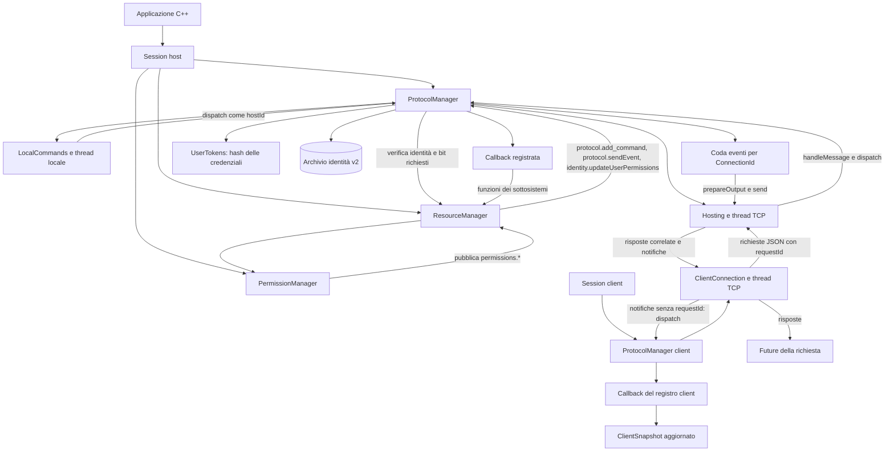
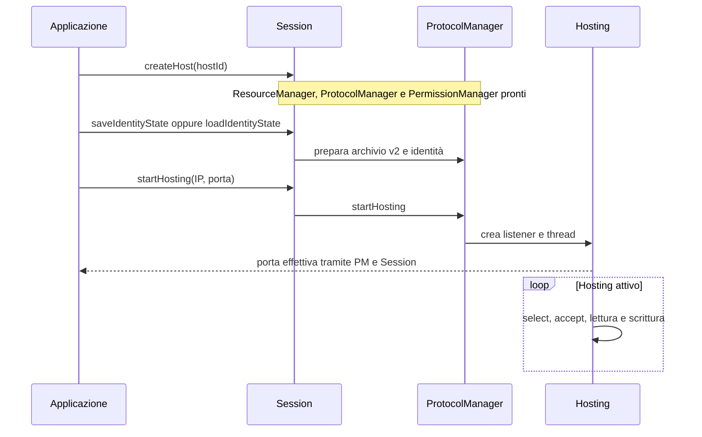
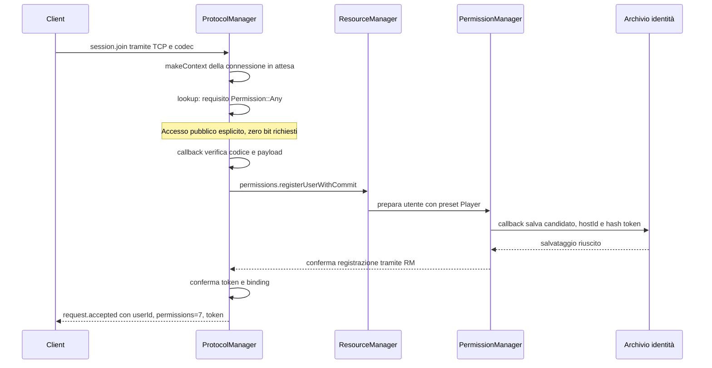
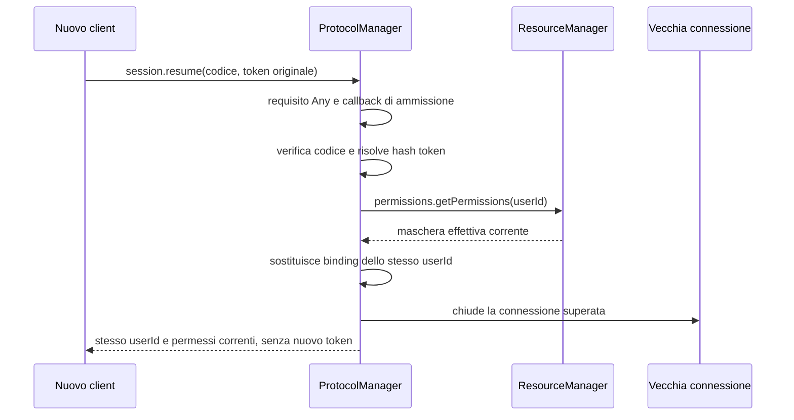
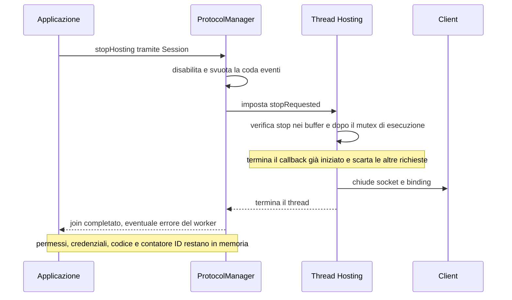
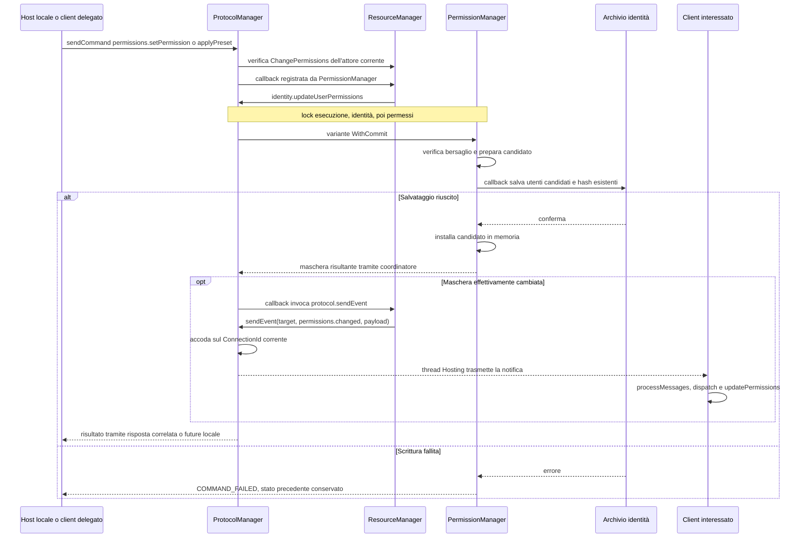
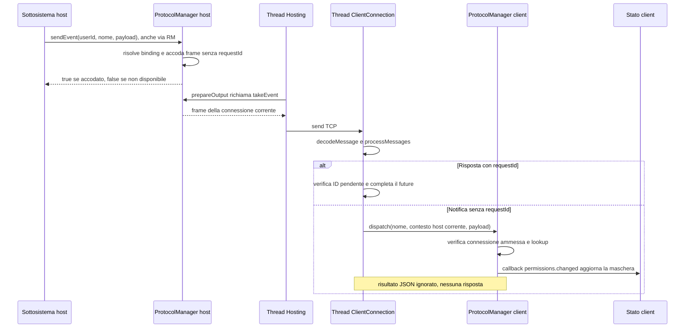
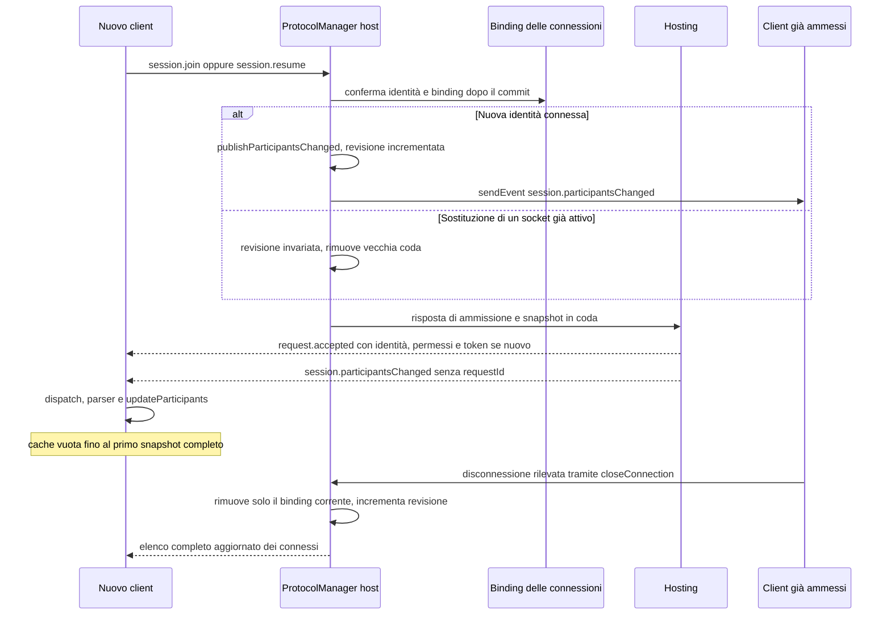

# Flusso delle comunicazioni

Aggiornato al 2026-11-18: Session usa PermissionManager, JSON v3 e archivi v2 numerici. Host e client riusano registrazione e dispatch dei comandi; permissions.changed aggiorna soltanto il client interessato dopo una modifica effettiva salvata. Passano diciassette suite CTest dalla configurazione CMake della root, con output in build/core/play. Le vecchie collisioni dei nomi e le richieste durante lo stop restano risolte; le riproduzioni storiche sono separate in history/.

## Proprietà e collegamenti



La Session client possiede ResourceManager/ProtocolManager, senza autorità locale sui permessi. La Session host possiede anche PermissionManager. Ogni ProtocolManager ha il proprio registro: sul server riceve richieste, sul client notifiche. Il registro delle feature RM resta distinto e una feature permissions.* non diventa automaticamente un RPC. CommandContext contiene solo identità e connessione, mai una maschera fidata dal payload. Sul client il mittente è il collegamento all'host ammesso, senza inventare un UserId dell'host. Il codec tratta struttura/framing; il dispatcher verifica la provenienza e, sull'host, i permessi correnti.

## Avvio



L'host esiste prima del listener, ha tutti i sei bit ed è identificato separatamente da hostId. Il codice della sessione nasce nel ProtocolManager e resta stabile durante stop/riavvio di quell'oggetto. La porta zero richiede un'assegnazione al sistema operativo. Non serve polling applicativo.

## Primo ingresso



Se il salvataggio fallisce, il nuovo utente/token non viene installato e il binding viene annullato. Any non è assegnabile agli utenti. Una maschera richiesta ordinaria vuota ha invece accesso autenticato: non consente a una connessione anonima di eseguire il comando.

## Comando remoto o locale

```mermaid
sequenceDiagram
    participant C as Client o applicazione host
    participant PM as ProtocolManager
    participant RM as ResourceManager
    participant P as PermissionManager
    participant CB as Callback
    C->>PM: sendCommand(nome, payload)
    Note over C,PM: Client: richiesta TCP correlata; host: coda locale come hostId
    PM->>PM: mutex esecuzione e contesto corrente
    PM->>RM: permissions.hasPermissions(userId, bit richiesti)
    RM->>P: verifica tutti i bit attuali
    P-->>PM: autorizzato oppure negato tramite RM
    alt Autorizzato
        PM->>CB: callback(contesto, payload)
        CB-->>PM: risultato JSON
        PM-->>C: future completata, con risposta correlata per TCP
    else Negato
        PM-->>C: errore FORBIDDEN
    end
```

La maschera viene letta per ogni esecuzione; una revoca interessa le richieste successive. Un callback già iniziato può terminare. Anche con tutti i bit, un utente diverso dall'host non può assegnare CambiaPermessi: PermissionManager verifica l'identità dell'attore e il bersaglio. I delegati non possono cambiare i propri permessi né quelli dell'host. I contesti chiusi/sostituiti e gli attori inventati non vengono trattati come anonimi.

## Riconnessione



Il vecchio client non può inviare comandi usando il binding sostituito; una sua chiusura tardiva non rimuove il nuovo binding. Il token è legato all'archivio della Session, non a IP o socket. Dopo un riavvio dell'applicazione si carica l'archivio v2 e si usa il codice corrente. I permessi possono essere una combinazione personalizzata o zero, senza conversione in preset.

## Stop e distruzione



Stop non drena le richieste bufferizzate e non garantisce l'invio dell'ultima risposta/notifica. I comandi locali restano disponibili senza hosting. La distruzione di Session chiude anche la coda locale, annulla il lavoro in attesa e attende un callback attivo prima di distruggere PermissionManager. Le operazioni di lifecycle e sendCommand dalla stessa callback sono rifiutate. sendEvent è consentita perché accoda senza prendere il mutex del lifecycle o scrivere sul socket. I callback client possono leggere getClientState senza bloccare il thread che sta eseguendo disconnectFromHost.

## Esempi JSON correnti

Ingresso e risposta:

```json
{"version":3,"type":"session.join","requestId":"client-1","payload":{"sessionCode":"A7K2Q"}}
{"version":3,"type":"request.accepted","requestId":"client-1","payload":{"result":{"userId":"user-example","permissions":7,"userToken":"0123456789abcdef"}}}
```

Comando già registrato e risultato, che può essere anche uno scalare o null:

```json
{"version":3,"type":"example.echo","requestId":"client-2","payload":{"value":12}}
{"version":3,"type":"request.accepted","requestId":"client-2","payload":{"result":12}}
```

Rifiuto di un comando senza i bit necessari:

```json
{"version":3,"type":"request.rejected","requestId":"client-3","payload":{"code":"FORBIDDEN","message":"Non hai i permessi per eseguire questo comando."}}
```

Archivio identità, con host distinto da un partecipante anche se entrambi avessero tutti i bit:

```json
{"version":2,"hostId":"host","users":[{"userId":"host","permissions":63},{"userId":"user-example","permissions":18}],"tokens":[]}
```

I vecchi messaggi JSON v2 e gli archivi a ruoli v1 sono rifiutati. In archivio si salvano hash dei token; l'esempio omette le credenziali. ClientSnapshot aggiorna i propri permessi con permissions.changed e l'elenco dei connessi con session.participantsChanged. session.getParticipants legge lo stesso elenco sull'host. Entrambi gli eseguibili devono supportare gli eventi emessi: una build precedente priva del nuovo nome non può riceverlo. Gli RPC sono descritti in session-permission-commands.md e la presenza in session-participants.md.

## Modifica transazionale dei permessi



I callback di commit non richiamano i manager. La stessa operazione funziona offline sull'host dopo aver configurato un archivio. Solo il bersaglio riceve la notifica; chi esegue il comando riceve il risultato ordinario. Non esiste un ordine globale di consegna fra due connessioni diverse: il diagramma indica la dipendenza dal commit. Un bersaglio offline riceve il valore corrente al resume. Gli errori di autorizzazione del dominio diventano FORBIDDEN, distinti dai payload errati INVALID_REQUEST. Le modifiche dirette ai manager restano operazioni fidate in memoria, senza salvataggio o evento automatico.

## Ricezione di una notifica e convivenza con le risposte



```json
{"version":3,"type":"permissions.changed","payload":{"userId":"user-example","permissions":23}}
```

Risposte e notifiche possono arrivare nello stesso blocco TCP o in frammenti. Gli eventi non consumano future e non rinnovano i timeout dei comandi. La coda ha un massimo di 64 notifiche e 256 KiB per connessione, oltre al frame in trasmissione; un overflow chiude il peer per consentire una risincronizzazione esplicita. Il binding sostituito non viene riusato per il nuovo socket. Nessuno storico delle notifiche viene salvato.

## Funzioni coinvolte e responsabilità

| Passaggio | Funzioni principali | Implementazione |
| --- | --- | --- |
| Facade applicativa | createHost/createClient, startHosting/stopHosting, joinSession/resumeSession, add_command, sendCommand/sendEvent | core/play/src/session.cpp: solo delega e costruzione dei manager. |
| Registrazione | PermissionManager::registerCommands, ProtocolManager::registerAdmissionCommands/registerClientCommands, add_command/registerCommand | permission_commands.cpp, admission.cpp, protocol_manager.cpp: callback e requisiti, un registro per istanza. |
| Avvio server | ProtocolManager::startHosting, Hosting::Impl constructor/run/poll | protocol_manager.cpp, hosting.cpp: listener e thread TCP. |
| Collegamento client | ProtocolManager::startClient, ClientConnection::start/run/connect/sendRequest/receiveReply | protocol_manager.cpp, client_connection.cpp: connessione, ammissione e future. |
| Ammissione sull'host | Hosting::acceptConnection/processInput, registerConnection, handleMessage/handleCommand, makeContext/dispatch, admitNewUser/resumeUser, bindUser | hosting.cpp, admission.cpp, protocol_manager.cpp: contesto, codice/token, persistenza e binding. |
| Richiesta remota | ClientConnection::sendCommand/monitor, Hosting::receive/processInput, ProtocolManager::handleCommand/dispatch | client_connection.cpp, hosting.cpp, admission.cpp: richiesta correlata e verifica corrente dell'attore. |
| Richiesta locale dell'host | ProtocolManager::sendCommand, LocalCommands::submit/run, dispatch | protocol_manager.cpp, local_commands.cpp: coda separata, esecuzione come hostId senza TCP. |
| Mutazione persistente | changePermissions, identity.updateUserPermissions, ProtocolManager::updateUserPermissions, setPermissionWithCommit/applyPresetWithCommit, writeIdentityState | permission_commands.cpp, protocol_manager.cpp, permission_manager.cpp, identity_storage.cpp: commit prima dello stato confermato e della notifica. |
| Risposta al comando | makeCommandReply/makeRejection, encodeMessage, Hosting::send, ClientConnection::processMessages | admission.cpp, protocol.cpp, hosting.cpp, client_connection.cpp: risultato/errore e completamento del future corretto. |
| Notifica mirata | ProtocolManager::sendEvent/takeEvent, Hosting::prepareOutput/send, ClientConnection::processMessages, dispatch | protocol_manager.cpp, hosting.cpp, client_connection.cpp: stessa rete, percorso di ricezione distinto dalle risposte. |
| Aggiornamento permessi client | callback di registerClientCommands, ClientConnection::updatePermissions, getClientState/snapshot | protocol_manager.cpp, client_connection.cpp: maschera dell'utente ammesso sotto mutex. |
| Arresto e sostituzione | stopHosting, disconnectFromHost, closeConnection/bindUser, Hosting::stop, ClientConnection::stop | protocol_manager.cpp, hosting.cpp, client_connection.cpp: join, pulizia code e invalidazione della generazione precedente. |

## Esito della verifica strutturale

I percorsi di comando, risposta e notifica condividono codec e trasporto; solo le richieste sull'host consultano PermissionManager. Il client non interpreta i propri bit come autorità. Le callback di modifica emettono dopo il commit, senza trattenere il mutex dei permessi. La coda di uscita evita di prendere hostingMutex dal callback; il riferimento attivo client evita di prendere clientMutex durante dispatch e lettura dello snapshot. I checkpoint dello stop restano davanti all'esecuzione delle richieste bufferizzate.

Verifica eseguita con diciassette suite CTest, incluse presenza dei connessi, notifiche senza richieste pendenti, frame misti/frammentati, deadline, persistenza, limiti della coda e stop concorrenti. Restano separati riconnessione automatica, schede, heartbeat e persistenza completa della partita. Il resume usa il token originale e restituisce permessi correnti, seguito dallo snapshot dei partecipanti.

## Elenco dei partecipanti connessi



Il comando session.getParticipants, registrato con accesso autenticato e zero bit richiesti, restituisce lo stesso payload dell'evento. Lo snapshot deriva da activeConnections_/connections_ e permissions.getHostId, senza un secondo registro. ParticipantInfo espone soltanto UserId/isHost; il contatore revision non è persistente. Il client scarta revisioni più vecchie, rifiuta conflitti e svuota la cache quando si scollega. Una chiusura tardiva del socket sostituito non modifica l'elenco. Dettagli e schema sono in session-participants.md.
